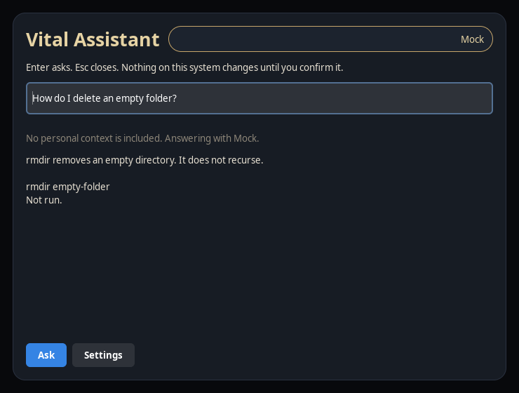
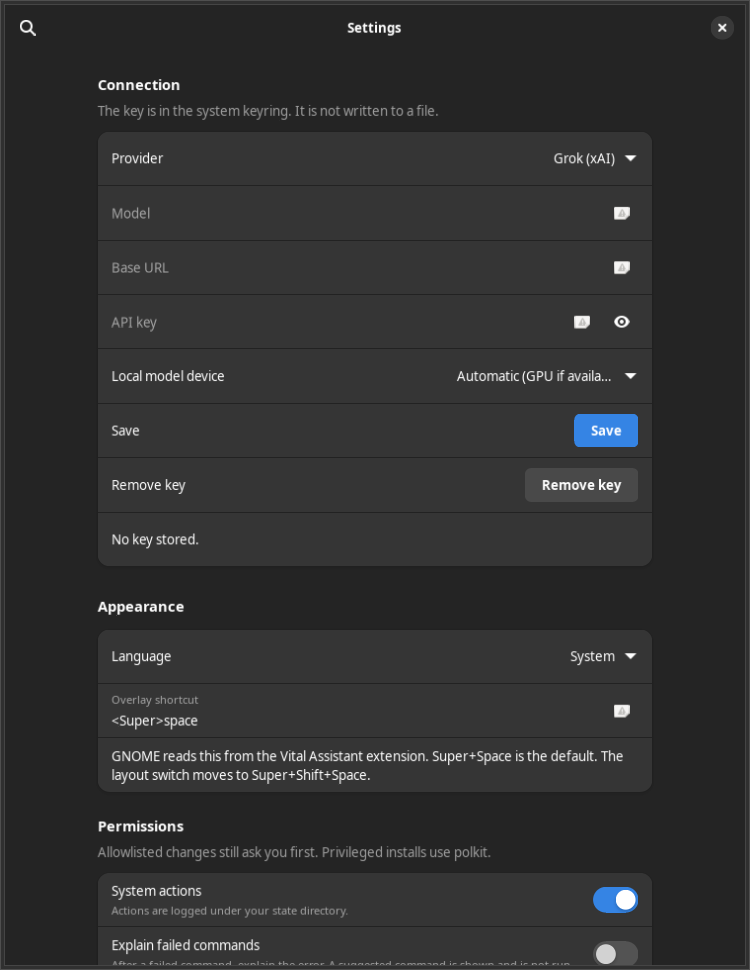
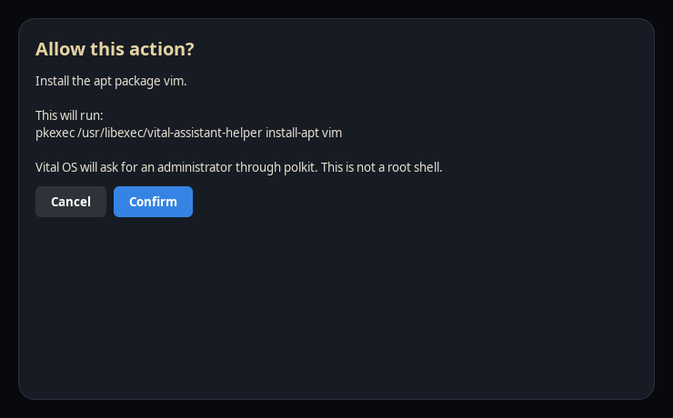
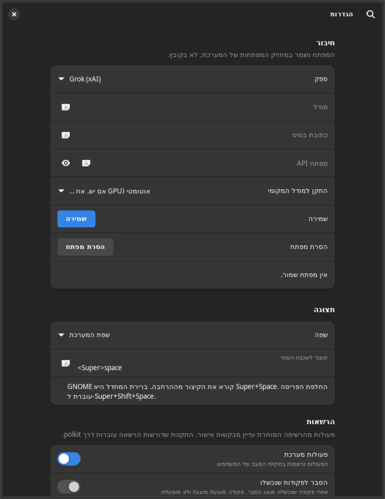

# Vital Assistant

Vital Assistant 0.3.0 is one program with four surfaces: the terminal, a floating overlay, a settings window, and a per-user daemon. They share providers, history, permissions, and settings. Prompts are not sent to vital-os.org and are not part of the install count in [PRIVACY.md](../PRIVACY.md).

The package is `vital-assistant` 0.3.0. Vital OS itself stays 0.2.1 until Tal cuts a release. The image build installs the deb. Marketplace can update an older image after the catalog signature matches.

## Surfaces

| Surface | How it opens | What it talks to |
| --- | --- | --- |
| Terminal | `vital ask`, `vital suggest`, `vital explain`, `ask`, `??` | The daemon when it is running, otherwise the same Python core in-process |
| Overlay | Super+Space, or Super+Shift+A, or the app grid | `vital-assistant --overlay` |
| Settings | Overlay button, or `vital-assistant --settings` | The same settings file and keyring |
| Quick Settings | GNOME extension `vital-assistant@vitalos` | Launches the overlay |

The daemon is the user service `vital-assistant.service`. It listens on `$XDG_RUNTIME_DIR/vital-assistant/ipc.sock` (mode 0600) and, when a session bus exists, on `org.vitalos.Assistant`. A second copy exits if the socket already answers.

## Providers

The default is still Grok through the user's own key from [console.x.ai](https://console.x.ai). The key is stored with libsecret under the schema `org.vitalos.Assistant`. It is not written to `assistant.conf`, not printed by `vital status`, and not put in the action log. `vital disconnect` deletes it.

Other providers:

| Name | Where the prompt goes |
| --- | --- |
| `grok` | `https://api.x.ai/v1` |
| `openai` | The base URL in settings, or `https://api.openai.com/v1` |
| `ollama` | `http://127.0.0.1:11434` by default |
| `local` | llama.cpp's `llama-server` on `127.0.0.1` |
| `auto` | Grok when a key is stored and the network works, otherwise local |

If Grok is selected and the key is missing, or the network request fails, and the local model is installed, the answer comes from the local model. The terminal prints the reason. The overlay shows the provider name on the pill. A bad API key (HTTP 401) does not fall over to local; that is a credential problem, not an outage.

## Local model

The Marketplace item **Vital Local Model** is a script. Marketplace shows it and asks before it runs. The script refuses the download if the SHA-256 does not match.

Checked on 2026-11-09 against the publishers' own files:

| Piece | File | License | SHA-256 |
| --- | --- | --- | --- |
| Model | `Qwen3-0.6B-Q8_0.gguf` from [Qwen/Qwen3-0.6B-GGUF](https://huggingface.co/Qwen/Qwen3-0.6B-GGUF) | Apache-2.0 | `9465e63a22add5354d9bb4b99e90117043c7124007664907259bd16d043bb031` |
| CPU runtime | llama.cpp `b12212` `llama-b12212-bin-ubuntu-x64.tar.gz` | MIT | `a9b987738e6724b116980de8f5e15a901a3086587c3d2328533d77582e25ad5b` |
| GPU runtime | `llama-b12212-bin-ubuntu-vulkan-x64.tar.gz`, only if `/dev/dri/renderD128` exists | MIT | `1f4c94a3a38b52ed632924aba9cdfa736caaa3ea7812b62ca1d8b84917eb3e15` |

The official Qwen repository currently publishes the Q8_0 file and does not publish a Q4_K_M file. The script installs that Q8 file (639446688 bytes). CPU is the default. Vulkan is used only when that build was installed and a render node exists, or when settings say `local_device=gpu`. `local_device=cpu` stays on CPU. The server is started with `--host 127.0.0.1`, `--reasoning off`, and `--no-webui`. The model is text-only, so a screenshot is not sent to it.

Pins live in `apps/vital-assistant/local-model.json`. The shell script repeats them so a reviewer can see the hashes without opening another file. `VITAL_LOCAL_MODEL_DRY_RUN=1` prints the pins and downloads nothing.

## Terminal

```bash
vital ask "how do I delete an empty folder"
vital suggest "list the files here"
vital explain
echo "command not found" | vital ask "what does this mean"
```

A suggested command is printed and is not run until you confirm. `y` is enough for an ordinary command. Something that looks like `rm -rf`, `dd`, `mkfs`, or a download piped into a shell needs `yes` or the command typed back. `vital ask` with a pipe treats stdin as the error text, never as the confirmation, so `printf y | vital ask ...` does not run anything.

Bash and zsh define `ask` and `??`. With `shell_hook=1`, a failed command is explained. The explanation may include a suggestion. The hook calls `vital ask --from-hook` with stdin from `/dev/null`, so the suggestion is not run. Stderr is copied to a file under the runtime directory only while the hook is on.

The layout switch is not Super+Space anymore on a fresh Vital OS image. See the shortcut section.

## Overlay and shortcut

Super+Space opens the overlay. The GNOME Shell extension grabs it, which is what works on Wayland under GNOME 46. Quick Settings has a Vital Assistant button. Super+Shift+A still launches the assistant through the media-keys binding.

The keyboard layout switch moves to Super+Shift+Space, and the reverse switch to Alt+Super+Space, in the dconf defaults. Hebrew input still has a shortcut. An existing home directory that already saved the old binding keeps it until that user changes it.

The shortcut is configurable in Settings. The value is an accelerator such as `<Super>space` or `<Super><Shift>a`. Esc closes the overlay. Enter asks. The confirmation panel does not confirm on Enter; Cancel starts focused.

## System actions

The model can ask for an action. The core accepts only these names:

| Action | Changes the system | Privilege |
| --- | --- | --- |
| `gnome.set` | Yes, one allowlisted key | Your user, via `gsettings` |
| `app.open` | Yes, a known `.desktop` file or a short name such as `files` | Your user, via `gtk-launch` |
| `apps.search` | No | `apt-cache search` plus the bundled catalog |
| `apps.install` / `apps.remove` | Yes | polkit, then `vital-assistant-helper` |
| `status.disk` | No | `df -h /` |
| `status.updates` | No | `apt-get -s upgrade` (simulation) |
| `status.battery` | No | reads `/sys/class/power_supply` |
| `status.network` | No | `nmcli` |

The helper accepts only `install-apt`, `remove-apt`, `install-flatpak`, `remove-flatpak`, `install-marketplace`, and `remove-marketplace`, plus one name that matches a fixed pattern. Package names cannot contain spaces, slashes, or shell punctuation. The daemon rebuilds the plan from the action name and arguments. A client that substitutes `bash -lc` is ignored.

Every state-changing action shows the summary and the exact argv. Privileged ones say that polkit will ask and that this is not a root shell. Cancel is the default. The attempt, the approval, and the result are appended to `~/.local/state/vitalos/assistant/actions.log` (mode 0600). The log is redacted for bearer tokens and `sk-` / `xai-` keys.

GNOME keys on the list include color scheme, Adwaita or Adwaita-dark, Papirus or Adwaita icons, text scaling between 0.7 and 2.5, clock seconds, battery percentage, hot corners, night light, event sounds, window buttons, touchpad tap and natural scroll, and the dock edge.

## Context

Private by default. Settings can reveal four chips: selected files, the active window, the clipboard, and a screenshot. Each question starts with those chips off. Turning one on is the consent for that question.

The disclosure line names what is included and which provider will receive it. If any of those four is on and the user has not allowed a remote send for that question, the core uses the local model when it is installed. If it is not installed, the request is refused and nothing is sent. Files named like keys (`id_rsa`, `.pem`, `.ssh`) are not attached. The active window is read from the Shell extension over the session bus at the moment of the question; it is not written to a history of focus changes. A screenshot goes through the desktop portal, which shows its own dialog. The local Qwen model does not receive the image.

Shell context (directory, last command, exit code, distro, and captured stderr) is separate. It is included when `send_context=1`, or when you run `vital explain`, or when the failure hook is on. That is the opt-in for the terminal.

## History and language

Questions and answers are stored in `~/.local/state/vitalos/assistant/history.jsonl` on this computer. Settings can erase that file. The action log is separate and is not erased by that button. Set `history_enabled=0` to stop recording.

The interface is English or Hebrew. Hebrew sets GTK's right-to-left direction. `language=system` follows `LANG` / `LC_MESSAGES`.

## Build and checks

```bash
./build.sh check
python3 -m unittest discover -s apps/vital-assistant/tests -t apps/vital-assistant
tools/assistant-smoke.sh
tools/assistant-qemu-smoke.sh
```

`assistant-qemu-smoke.sh` always runs the headless smoke. It boots `build/output/VitalOS-<version>-amd64.iso` only when that file and `qemu-system-x86_64` exist. The ISO is not built in ordinary CI.

The catalog entry is produced by `marketplace/tools/build_catalog.py`. The deb is gitignored. The sample catalog in git is unsigned, which is the same rule as the rest of the sample: the server signs with the private key that is not in this repository. A test can sign a copy with a throwaway key and verify it; the production public key is still the placeholder until Tal installs a real one.

## Screenshots

Taken from the GTK app under Xvfb on the build host, with the mock provider so no key or network was used. They are not a photo of a full Vital OS desktop session.









## Local benchmark

`llama-bench` from llama.cpp b12212, model `Qwen3-0.6B-Q8_0.gguf`, `-ngl 0 -t 4 -p 128 -n 64 -r 2`. `--list-devices` reported no GPU, and the loaded backend was `libggml-cpu-sapphirerapids.so`.

| Test | Result |
| --- | --- |
| Prompt processing (128 tokens) | 1028.08 ± 3.89 tok/s |
| Generation (64 tokens) | 94.56 ± 1.51 tok/s |

Host: 4 vCPU, `Intel(R) Xeon(R) Processor` (family 6, model 207), KVM, AVX-512, no render node. These numbers are for this machine only.

## Decisions for Tal

- The assistant package is 0.3.0 while `VERSION` is still 0.2.1, so this branch does not pretend a distro release. Tagging and publishing stay with you.
- Super+Space is the overlay. The layout switch moved to Super+Shift+Space in the image defaults.
- The local model is the official Q8_0 file, about 610 MiB, not a smaller Q4 file, because Qwen does not publish Q4 in that repository right now.
- Package installs use a normal admin polkit prompt. The live user has no password; installing from the assistant on the live session may need a local policy if you want it without a prompt.
- llama.cpp is pinned to build `b12212`, which is a daily tag. The next image can move the pin.
